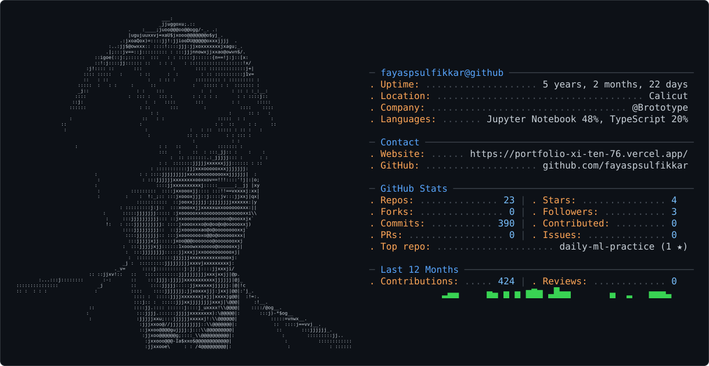

<!-- ═══════════════ ADAPTIVE ASCII PORTRAIT ═══════════════ -->

<picture>
  <source media="(prefers-color-scheme: dark)" srcset="dark_mode.svg" />
  <source media="(prefers-color-scheme: light)" srcset="light_mode.svg" />
  
</picture>
<!-- ═══════════════ CYBERPUNK IDENTITY ═══════════════ -->

<table width="100%" border="0">
<tr>
<td align="left">
◈ SYSTEM ONLINE &nbsp; / &nbsp; PERSONAL PROFILE
</td>
<td align="right">
AI // ML // RESEARCH
</td>
</tr>
</table>
 
<h2 align="center">
  <samp>⟢ FAYAS P SULFIKKAR ⟣</samp>
</h2>

 

  <samp>ASPIRING AI/ML ENGINEER</samp>
    
  Exploring intelligence. Understanding the mathematics. Building what's next.

 

 
<table width="100%">
<tr>
<td align="center" width="33%">
⌖ LOCATION
 
<b>CALICUT, INDIA</b>
</td>
<td align="center" width="34%">
◉ CURRENT FOCUS
 
<b>MACHINE LEARNING</b>
</td>
<td align="center" width="33%">
⌘ OPERATING MODE
 
<b>LEARN · BUILD · FAIL · REPEAT</b>
</td>
</tr>
</table>
 

━━━━━━━━━━━━━━━━━━━━━━━━━━━━━━━━━━━━━━━━━━━━━━━━━━
 
INITIALIZING THE FUTURE, ONE EXPERIMENT AT A TIME_
 
━━━━━━━━━━━━━━━━━━━━━━━━━━━━━━━━━━━━━━━━━━━━━━━━━━

<!-- ═══════════════ END CYBERPUNK IDENTITY ═══════════════ -->
