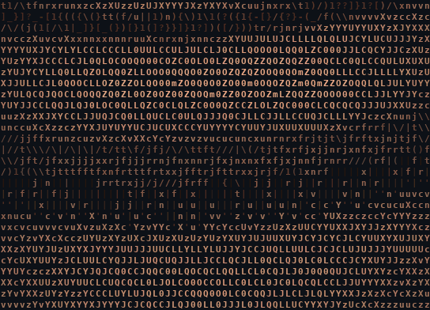

<!-- ═══════════════════════ GENERATIVE ASCII EYE → SPACE ANIMATION ═══════════════════════ -->

  

<!-- ═══════════════════════ NEUMORPHIC HERO BANNER ═══════════════════════ -->
<picture>
  <source media="(prefers-color-scheme: dark)" srcset="header.svg" />
  <source media="(prefers-color-scheme: light)" srcset="header_light.svg" />
  
</picture>

  

<!-- ═══════════════════════ SIGNATURE FIRST IMPRESSION ═══════════════════════ -->
<h3>
  📉 𝗚𝗿𝗮𝗱𝗶𝗲𝗻𝘁 𝗱𝗲𝘀𝗰𝗲𝗻𝘁 ᴏɴ ᴍʏ ʟɪғᴇ ᴄʜᴏɪᴄᴇs.  
  🎓 ᴀɪ/ᴍʟ sᴛᴜᴅᴇɴᴛ, sᴛɪʟʟ ᴄᴏɴᴠᴇʀɢɪɴɢ.  
  ☕ ᴏᴠᴇʀғɪᴛᴛɪɴɢ ᴏɴ ᴄᴀғғᴇɪɴᴇ, ᴜɴᴅᴇʀғɪᴛᴛɪɴɢ ᴏɴ sʟᴇᴇᴘ. 😴
</h3>

  Exploring intelligence &nbsp;•&nbsp; Understanding the mathematics &nbsp;•&nbsp; Building what's next

  

<!-- ═══════════════════════ FEATURED PROJECTS SHOWCASE ═══════════════════════ -->

  <h3>⟢ FEATURED BUILDS &amp; RESEARCH</h3>

<table width="100%">
<tr>
<td width="50%" valign="top">

### 🧠 [Cerebrum App](https://github.com/fayaspsulfikkar/cerebrum-app)
> **Brain encoding foundation platform predicting localized fMRI brain activity from video.**
- Leverages Meta's **TRIBE v2** multimodal neural encoder.
- Predicts human cognitive responses directly from standard `.mp4` video files.
- `Meta TRIBE v2` • `PyTorch` • `fMRI Simulation` • `FastAPI`

[View Repository](https://github.com/fayaspsulfikkar/cerebrum-app) &nbsp;|&nbsp; [Research Paper](https://github.com/fayaspsulfikkar/crbrm_rsrch_ppr)

</td>
<td width="50%" valign="top">

### 👁️ [Ayush Tracker](https://github.com/fayaspsulfikkar/ayush_tracker)
> **Private, offline-first study focus tracker running computer vision directly in the browser.**
- Powered by client-side **MediaPipe WASM** for zero-latency face and gaze tracking.
- Zero server-side video feeds or cloud telemetry — total user privacy by design.
- `MediaPipe WASM` • `Computer Vision` • `JavaScript`

[View Repository](https://github.com/fayaspsulfikkar/ayush_tracker) &nbsp;|&nbsp; [Live App](https://ayushtracker.vercel.app)

</td>
</tr>

<tr>
<td width="50%" valign="top">

### ⚡ [Ola KeyApp](https://github.com/fayaspsulfikkar/ola-keyapp)
> **Reverse-engineering the Ola S1 Pro (MoveOS 5.0) Bluetooth Low Energy protocol.**
- Packet-sniffed and decoded proprietary BLE handshake and telemetry exchanges.
- Custom companion features, proximity unlock experimentation, and Mod APK boundaries.
- `Kotlin` • `BLE Protocol Analysis` • `Android Architecture`

[View Repository](https://github.com/fayaspsulfikkar/ola-keyapp)

</td>
<td width="50%" valign="top">

### 📓 [Daily ML Practice &amp; Self Log](https://github.com/fayaspsulfikkar/daily-ml-practice)
> **Mathematical foundations, algorithms from scratch, and reconstruction log.**
- Weekly exercises: backprop from first principles, optimization math, and neural architectures.
- Coupled with the **Life OS / Self Log** tracking system iterations from 2019 to 2026.
- `Python` • `PyTorch` • `NumPy` • `Optimization Math`

[ML Practice](https://github.com/fayaspsulfikkar/daily-ml-practice) &nbsp;|&nbsp; [Self Log Interface](https://fayaspsulfikkar.github.io/self-log/)

</td>
</tr>
</table>

