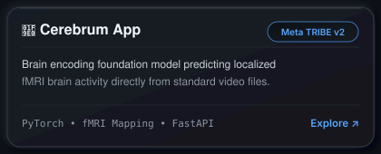
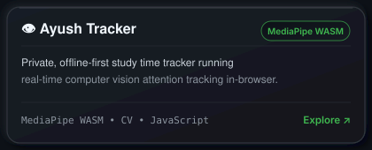
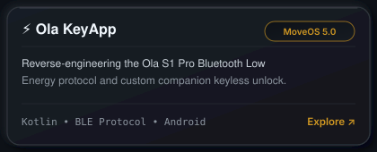
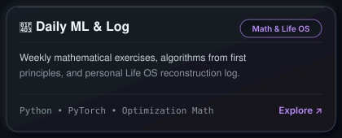

<!-- ═══════════════════════ GENERATIVE ASCII EYE → SPACE ANIMATION ═══════════════════════ -->

  

<!-- ═══════════════════════ NEUMORPHIC HERO BANNER ═══════════════════════ -->
<picture>
  <source media="(prefers-color-scheme: dark)" srcset="header.svg" />
  <source media="(prefers-color-scheme: light)" srcset="header_light.svg" />
  
</picture>

  

<!-- ═══════════════════════ SIGNATURE FIRST IMPRESSION ═══════════════════════ -->
<h3>
  📉 𝗚𝗿𝗮𝗱𝗶𝗲𝗻𝘁 𝗱𝗲𝘀𝗰𝗲𝗻𝘁 ᴏɴ ᴍʏ ʟɪғᴇ ᴄʜᴏɪᴄᴇs.  
  🎓 ᴀɪ/ᴍʟ sᴛᴜᴅᴇɴᴛ, sᴛɪʟʟ ᴄᴏɴᴠᴇʀɢɪɴɢ.  
  ☕ ᴏᴠᴇʀғɪᴛᴛɪɴɢ ᴏɴ ᴄᴀғғᴇɪɴᴇ, ᴜɴᴅᴇʀғɪᴛᴛɪɴɢ ᴏɴ sʟᴇᴇᴘ. 😴
</h3>

  Exploring intelligence &nbsp;•&nbsp; Understanding the mathematics &nbsp;•&nbsp; Building what's next

  

<!-- ═══════════════════════ FEATURED PROJECTS SHOWCASE (NATIVE NEUMORPHIC SVG CARDS) ═══════════════════════ -->

  <h3><samp>⟢ FEATURED BUILDS &amp; RESEARCH</samp></h3>

  <a href="https://github.com/fayaspsulfikkar/cerebrum-app">
    <picture>
      <source media="(prefers-color-scheme: dark)" srcset="card_cerebrum.svg" />
      <source media="(prefers-color-scheme: light)" srcset="card_cerebrum_light.svg" />
      
    </picture>
  </a>
  <a href="https://github.com/fayaspsulfikkar/ayush_tracker">
    <picture>
      <source media="(prefers-color-scheme: dark)" srcset="card_ayush.svg" />
      <source media="(prefers-color-scheme: light)" srcset="card_ayush_light.svg" />
      
    </picture>
  </a>

  <a href="https://github.com/fayaspsulfikkar/ola-keyapp">
    <picture>
      <source media="(prefers-color-scheme: dark)" srcset="card_olakey.svg" />
      <source media="(prefers-color-scheme: light)" srcset="card_olakey_light.svg" />
      
    </picture>
  </a>
  <a href="https://github.com/fayaspsulfikkar/daily-ml-practice">
    <picture>
      <source media="(prefers-color-scheme: dark)" srcset="card_dailyml.svg" />
      <source media="(prefers-color-scheme: light)" srcset="card_dailyml_light.svg" />
      
    </picture>
  </a>

